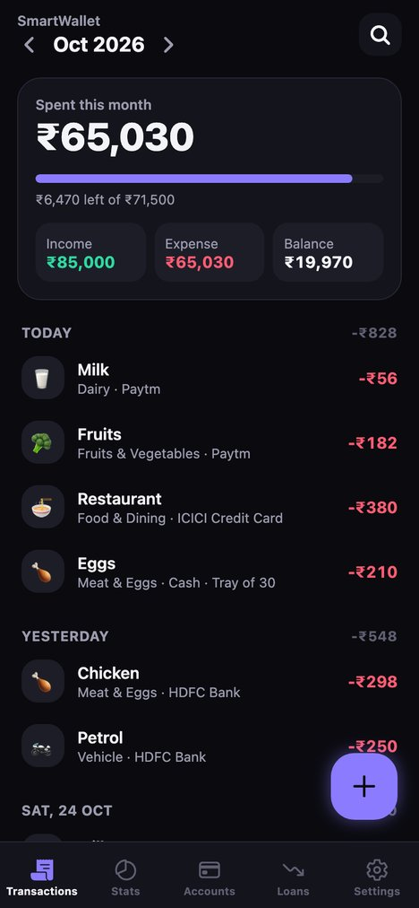
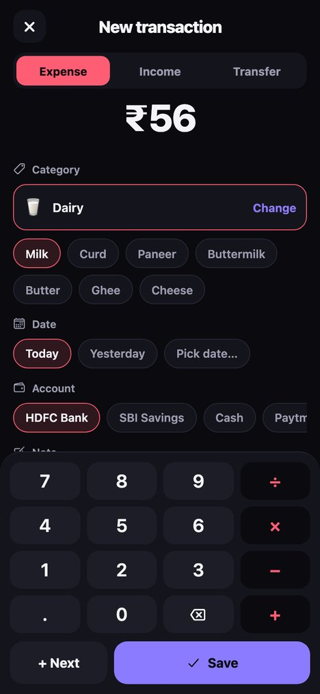
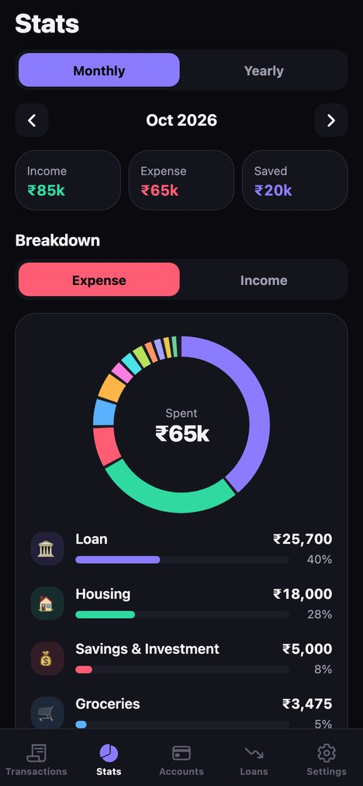
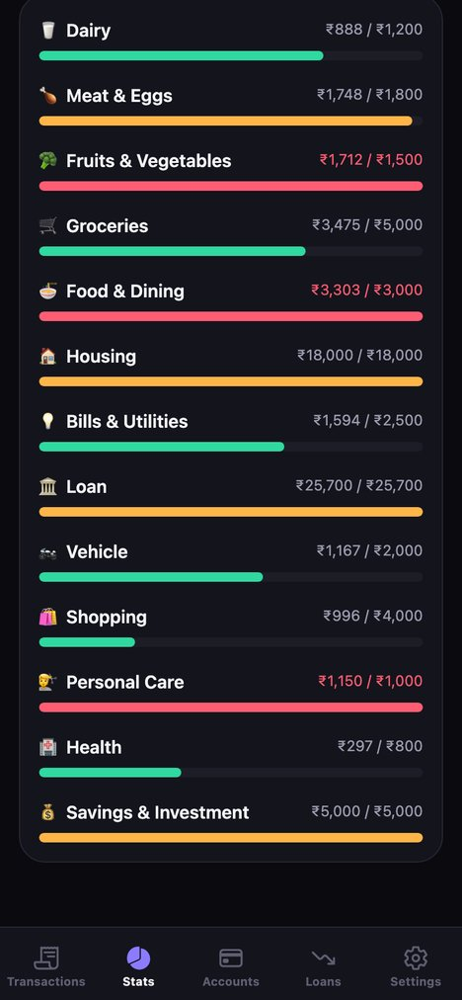
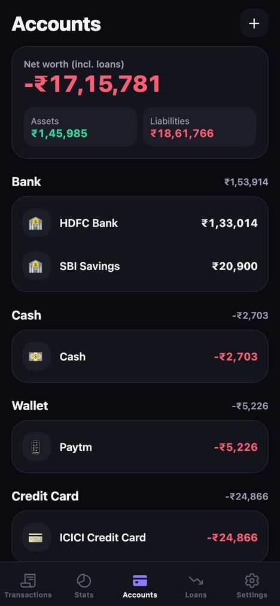
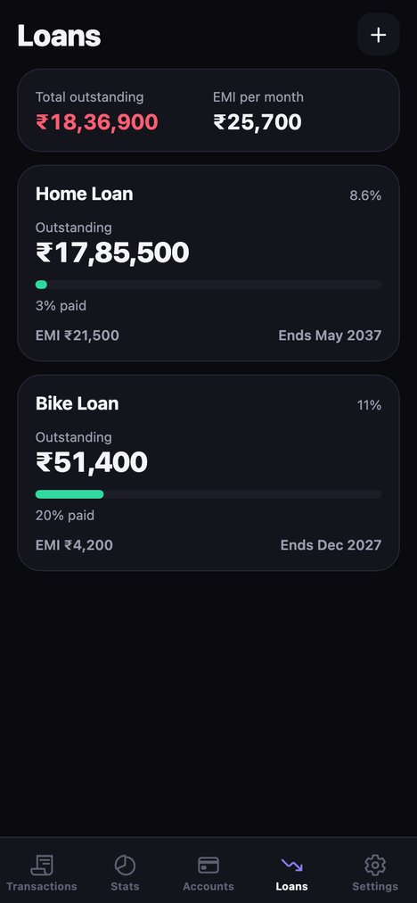
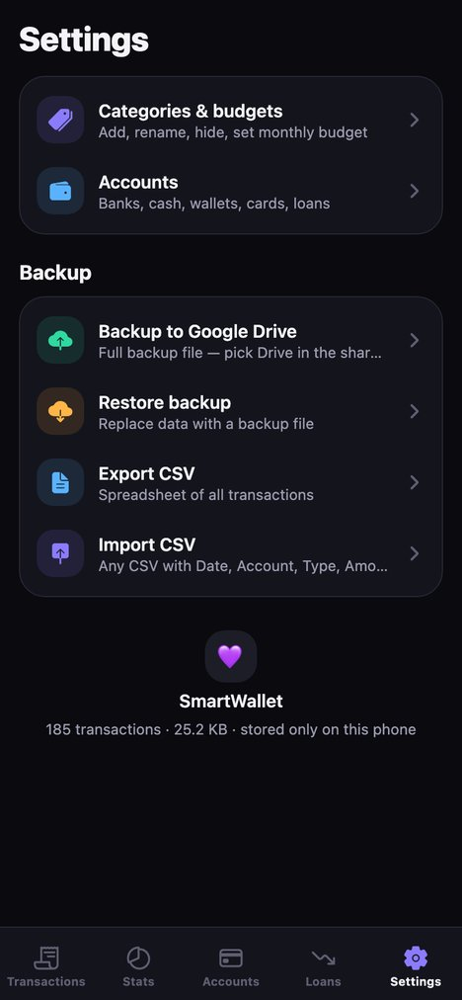

<div align="center">


# SmartWallet

**An offline-first personal finance tracker for Android.**
Log expenses in seconds by tapping or just speaking, see where your money goes, stay within budget and track loans to the last EMI. All data stays on your phone; voice entry is optional and, when used, sends only the recording plus your category and account names to Gemini.


**[⬇ Download the latest APK](https://github.com/thekirankumarv/SmartWallet/releases/latest)**

</div>

<p align="center">
  
  
  
  
</p>
<p align="center">
  
  
  
</p>

## Features

### Transactions
- Expense, income and transfer entries with a built-in calculator keypad (`40+7`, `2×120`, …)
- Two-tap categorisation: pick a category, then a subcategory (e.g. **Dairy → Milk**)
- Quick date chips (Today / Yesterday) plus a native date picker
- **+ Next** to log several items in a row without leaving the screen
- Notes, edit, and delete with confirmation
- Month-by-month timeline grouped by day with daily totals

### Voice entry
- Hold the mic, say *"milk 47, petrol 205 yesterday, salary 60000 to savings"*, release
- Google Gemini turns speech into entries with the right category, subcategory, account and date ("yesterday", "last Friday", "on the 5th")
- Review screen before anything is saved: fix or remove entries, then save all at once
- Uses your own free Gemini API key, set up in **Settings → Voice entry**. The key is checked with Google before it's saved and stored encrypted on the phone, never in backups
- Clear messages for a wrong or expired key, used-up daily limit, no internet and busy servers

### Stats & budgets
- Monthly and yearly views with income, expense and savings
- Donut chart by category; tap a category to see its subcategory split
- Per-category monthly budgets with progress bars (green → amber → red)
- Month-by-month income vs expense bars for the year

### Accounts
- Bank accounts, cash, wallets, credit cards and your own custom types, all created by the user
- Credit card dues shown as the amount owed
- Live balances, net worth, assets vs liabilities
- Transfers between accounts; balance corrections are recorded as adjustments, never silent edits
- Hide accounts you no longer use without losing history

### Loans
- Dedicated tab with outstanding amount, % repaid and projected payoff month
- **Pay EMI** pre-fills a transfer from your bank to the loan
- Monthly interest is posted automatically at month end on the outstanding balance (reducing-balance method)

### Categories
- Ships with a clean, standard set (Dairy, Meat & Eggs, Groceries, Bills & Utilities, Vehicle, …)
- Add, rename, hide or delete categories and subcategories, and set budgets
- Items in use can only be hidden, so history is never orphaned

### Data & backup
- Search across notes, categories, accounts and amounts, with filters for date range, type, account and category
- **Backup** to Google Drive (or anywhere) through the Android share sheet, and **restore** from a backup file
- **CSV export** for spreadsheets, and **CSV import** with automatic matching and duplicate detection
- Every destructive action asks for confirmation first

## Tech stack

| Area | Choice |
|---|---|
| Framework | [Expo SDK 58](https://docs.expo.dev/), React Native 0.88, React 19 |
| Language | TypeScript (strict) |
| Navigation | [Expo Router](https://docs.expo.dev/router/introduction/) (file-based, tabs + modal stack) |
| State | [Zustand](https://github.com/pmndrs/zustand) |
| Storage | Single JSON file via `expo-file-system` (no database) |
| Charts | `react-native-svg` (hand-built donut and bar charts) |
| Files | `expo-sharing`, `expo-document-picker` |
| Native UI | `@react-native-community/datetimepicker`, `expo-haptics` |
| Voice | `expo-audio` (recording), Gemini API (`generateContent` with audio input and JSON schema output), `expo-secure-store` (API key) |
| Testing | Node assert + `tsx` (unit), Playwright (end-to-end on the web build) |
| Tooling | ESLint (`eslint-config-expo`), Prettier |

## Design notes

- **Money is stored as integer paise.** No floating-point drift in balances or interest.
- **Dates are local `YYYY-MM-DD` strings.** Using UTC timestamps in IST would push anything before 05:30 into the previous day.
- **Storage is one compact file.** Writes go to a temp file that is then atomically renamed, and the previous version is kept as a fallback. If the file can't be read, the app refuses to overwrite it and asks you to restore. Two years of daily entries is about 200 KB.
- **Saves are debounced** and also flushed when the app goes to the background.
- **Cash-flow rules for stats:**
  - Transfers between your own accounts are not spending.
  - Payments *into* a loan count as loan spending.
  - Interest posted on the loan account doesn't touch your cash, so it isn't double-counted.
  - Balance adjustments are excluded.
- **Pure core.** All business logic lives in `src/lib/ledger.ts` as pure functions over plain data, and the store is a thin wrapper. That's what makes it fully unit-testable.

## Project structure

```
src/
├── app/                    Expo Router screens
│   ├── (tabs)/             Transactions, Stats, Accounts, Loans, Settings
│   ├── account/            Account detail and editor
│   ├── category/           Category editor
│   ├── categories.tsx      Category list
│   ├── search.tsx          Search and filters
│   ├── tx.tsx              Add / edit transaction (modal)
│   ├── voice.tsx           Review entries from voice
│   └── voice-settings.tsx  Gemini API key setup
├── components/
│   ├── ui.tsx              Theme tokens and shared UI primitives
│   └── VoiceButton.tsx     Hold-to-talk recorder
└── lib/
    ├── ai.ts               Gemini request, reply parsing, key checks, error messages
    ├── voice.ts            API key storage, audio file reading
    ├── ledger.ts           Validation, balances, cash flows, loan interest, CRUD
    ├── store.ts            Zustand store + file persistence
    ├── csv.ts              CSV parse / export / import
    ├── io.ts               Backup, restore, share, file picking
    ├── money.ts            Formatting (₹ Indian grouping), calculator, date helpers
    ├── seed.ts             Default categories
    └── types.ts            Data model
scripts/e2e.mjs             End-to-end UI test
```

## Install

Download `SmartWallet-vX.Y.Z.apk` from [Releases](https://github.com/thekirankumarv/SmartWallet/releases/latest) on your Android phone (Android 7.0+, arm64) and open it to install. Updating to a newer release keeps your data.

## Getting started

**Requirements:** Node 20+, and either an Android phone with [Expo Go](https://expo.dev/go) or the Android SDK for native builds.

```bash
git clone https://github.com/thekirankumarv/SmartWallet.git
cd SmartWallet
npm install
npm start          # scan the QR code with Expo Go
npm run web        # or run in the browser
```

### Build an installable APK

Requires the Android SDK and JDK 17+ (`ANDROID_HOME` and `JAVA_HOME` set).

```bash
npm run apk        # outputs SmartWallet.apk in the project root
```

The release build targets `arm64-v8a` with R8 minification and resource shrinking (~17 MB).

## Testing

```bash
npm test           # unit tests: calculator, formatting, dates, CSV, ledger, loan interest, voice parsing and API errors
npm run e2e        # UI flow test (start `npm run web` first; run `npx playwright install chromium` once)
npm run typecheck
npm run lint
```

The end-to-end suite starts from a fresh install and walks through:
- creating accounts
- adding, editing and deleting transactions (cancel and confirm)
- transfers and income
- adding a loan and paying an EMI
- stats
- the guards that stop deleting accounts and categories still in use
- category and subcategory management
- search
- voice entry setup (key format and rejected-key messages) and the review screen
- data surviving a reload

## CSV format

Export and import use the same columns:

```csv
Date,Time,Type,Account,To Account,Category,Subcategory,Note,Amount
2026-10-24,08:15,Expense,HDFC Bank,,Dairy,Milk,,56
2026-10-01,,Income,HDFC Bank,,Salary,,,85000
2026-10-05,,Transfer,HDFC Bank,Home Loan,,,,21500
```

- **Required columns:** `Date`, `Account`, `Type` (`Expense` / `Income` / `Transfer`) and `Amount`.
- **Dates:** `YYYY-MM-DD` or `DD/MM/YYYY`.
- **Matching:** accounts, categories and subcategories are matched by name (case and punctuation insensitive). Missing ones are created.
- **Duplicates:** rows already in the app are skipped, so re-importing the same file is safe.

## License

[MIT](LICENSE) © Kiran Kumar V
